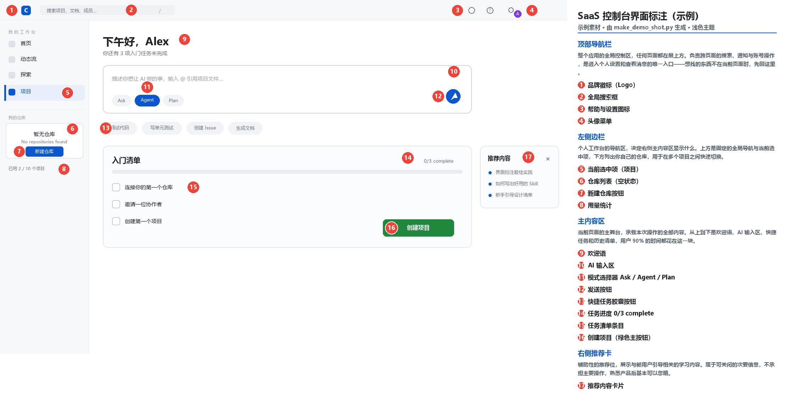

# Screenshot UI Explainer · 界面截图标注

把一个 AI Agent 变成「界面解说员」：丢给它一张软件截图，它还你一张**看得懂的标注图**和一份**可交互的说明页**。

> A skill that turns a raw UI screenshot into an annotated diagram plus a self-contained interactive HTML explainer — with precise dot placement driven by pixel scanning instead of eyeballing.



<p align="center"><em>示例产物：编号圆点落在界面元素旁，右侧按区域分组给出「这块地方是干什么用的」+ 逐项说明</em></p>

## 它产出什么

| 交付物 | 内容 | 适用场景 |
|---|---|---|
| **标注图 PNG** | 原图叠加编号圆点 + 右侧分组图例面板（含每个区域的功能说明） | 发群里、贴文档、PPT 里用 |
| **交互式 HTML** | 单文件自包含（图片 base64 内嵌），悬停编号 ↔ 图例双向高亮，点击互相滚动定位 | 发链接、让用户自己点着看 |

示例产物就在仓库里，可以直接打开看：

- 标注图：[`examples/output/demo-annotated.png`](examples/output/demo-annotated.png)
- 交互页：[`examples/output/demo-annotated.html`](examples/output/demo-annotated.html)（下载后用浏览器打开）

## 核心理念：先测区域、再量坐标、后交付

大多数"截图标注"做不好的原因只有两个：**区域划分太碎**、**圆点位置靠目测**。这个 skill 强制走三步：

1. **先分区域**——顶栏 / 侧栏 / 主内容 / 底栏。每个区域先写一段 50-90 字的「这块地方是干什么用的」，再逐条列控件。读者先理解结构，再看细节。
2. **坐标必须量**——用 `locate_elements.py` 按行带扫描像素，拿到真实的 x 区间与中心点。目测坐标必然让圆点压住文字。
3. **生成后必须回看**——把 PNG 读回来逐项检查圆点是否压字、图例是否被裁、编号与图例是否对得上。**不交付未经回看的首轮结果。**

## 使用方式

### 作为 Agent Skill 安装

本仓库根目录就是 skill 本体（`SKILL.md` 在根目录），直接克隆到 skills 目录即可：

```bash
git clone https://github.com/han719307-dotcom/screenshot-ui-explainer.git \
  ~/.workbuddy/skills/screenshot-ui-explainer
```

> `~` 在 Windows 上指 `C:\Users\<你的用户名>`。放到 `~/.workbuddy/skills/` 下即为用户级 skill；
> 放到项目的 `.workbuddy/skills/` 下则为项目级，团队共享。
> 如果你用的是支持 `SKILL.md` 规范的其他 Agent 工具，放进它对应的 skills 目录同理。

### 作为独立命令行工具使用

只想要那两个脚本，不想装 skill 也行：

```bash
git clone https://github.com/han719307-dotcom/screenshot-ui-explainer.git
cd screenshot-ui-explainer
python -m venv .venv
.venv/Scripts/pip install pillow      # Windows
# source .venv/bin/activate && pip install pillow   # macOS / Linux
```

## 三步走完流程

```bash
# 1) 量坐标：扫描顶部导航栏、侧栏、输入区，输出 x 区间与中心点
python scripts/locate_elements.py shot.png \
  --band "20 62 1700 2544:TOPBAR" \
         "115 180 0 520:SIDEBAR" \
         "350 395 880 2200:COMPOSER"

# 2) 写 annotations.json（格式见 references/annotations-schema.md）

# 3) 一条命令产出两份交付物
python scripts/build_annotation_demo.py shot.png annotations.json -o output --name 界面标注
```

也可以分开生成：

```bash
python scripts/annotate_png.py  annotations.json -o 标注图.png --theme light
python scripts/annotate_html.py annotations.json -o 界面标注.html --theme light
```

### 脚本一览

| 脚本 | 用途 | 何时用 |
|---|---|---|
| `locate_elements.py` | 按行带扫描亮色元素，输出 x 区间与中心点 | 定位坐标，必用 |
| `annotate_png.py` | 生成带编号 + 图例面板的标注图 PNG | 需要图片交付物时 |
| `annotate_html.py` | 生成自包含可交互标注页面 | 需要网页交付物时 |
| `build_annotation_demo.py` | 一条命令跑通全流程 | 两份都要时，推荐 |

常用参数：`--theme dark|light`（跟随 IDE 主题）、`--panel-width`（图例带宽，默认 620）、
`--font` / `--font-bold`（指定中文字体）、`--no-panel`（只画编号不拼图例）。

## 复现示例

仓库里的 demo 完全可复现，不需要你有现成截图：

```bash
cd examples
python make_demo_shot.py                     # 生成模拟界面截图 demo-dashboard.png
python ../scripts/annotate_png.py annotations.json -o output/demo-annotated.png --theme light
python ../scripts/annotate_html.py annotations.json -o output/demo-annotated.html --theme light
```

`examples/annotations.json` 同时也是**格式的最佳参考**：17 条标注覆盖 4 个区域，
演示了分组说明、按区域连续编号、以及用 `label_x` 把圆点从按钮文字上挪开的写法。

## annotations.json 速览

```json
{
  "title": "SaaS 控制台界面标注",
  "subtitle": "示例素材 · 浅色主题",
  "source": "demo-dashboard.png",
  "group_notes": {
    "顶部导航栏": "整个应用的全局控制区，任何页面都在最上方。负责跨页面的搜索、通知与账号操作……"
  },
  "annotations": [
    { "n": 1, "x": 33, "y": 29, "group": "顶部导航栏",
      "title": "品牌徽标（Logo）",
      "desc": "点击回到产品首页。" },

    { "n": 16, "x": 1180, "y": 644, "group": "主内容区",
      "title": "创建项目（绿色主按钮）",
      "desc": "卡片右下角的主操作按钮。",
      "label_x": 1104, "label_y": 644 }
  ]
}
```

| 字段 | 必填 | 说明 |
|---|---|---|
| `n` | ✅ | 编号，全局唯一，**按区域顺序连续编号**图例读起来才顺 |
| `x` / `y` | ✅ | 原图像素坐标，脚本自动换算百分比，**不要手工折算** |
| `group` | ✅ | 分组名，相同值自动归入同一图例分区 |
| `title` | ✅ | 条目标题，建议 `英文原名（中文解释）` |
| `desc` | 可选 | 详细说明，**只在 HTML 中展示** |
| `label_x` / `label_y` | 可选 | 圆点实际绘制位置，用于微调避免压字 |
| `group_notes` | ✅ | 每个分组一段区域功能说明，50-90 字 |

完整字段说明、坐标换算规则与常见错误见 [`references/annotations-schema.md`](references/annotations-schema.md)；
拆解界面时的部件中英文对照表见 [`references/common-ui-parts.md`](references/common-ui-parts.md)。

## 踩过的坑（已验证的实践结论）

- **图例可以比截图高**——标注 ≥ 11 条时图例自然超过原图高度，正确做法是加高整张画布（脚本已处理），而不是压缩行距或裁掉内容。
- **`label_x` / `label_y` 是最有用的逃生舱**——约 1/4 的标注需要单独微调圆点位置，尤其是绿色实心主按钮、`⋯` 更多菜单、长标题旁的编号。数据里保留 `x`/`y` 为元素真实中心，微调只写 `label_x`/`label_y`，后续换图重测时更容易分辨。
- **空状态和进度条必须标**——`No repositories found`、`0/3 complete` 这类元素用户往往最想问"这什么意思"，反而最容易被漏掉。
- **HTML 配色跟 IDE 主题走，不要跟截图走**；而截图区域本身保持原样不动。
- **深色截图配深色图例面板**看起来最像"一张图"。

## 已知限制

- `locate_elements.py` 的设计前提是**暗色背景上找亮色元素**（按行取列灰度最大值，超过阈值即视为有内容）。
  浅色界面的截图整行都会超过阈值，扫描结果会连成一片。此时请调高 `--threshold`
  或改用"反向"思路手工测量——**在浅色截图上，本项目示例数据是手工量的坐标**。
- 坐标与截图强绑定：截图被缩放或裁剪后必须重新测量，不能沿用旧值。
- 中文渲染依赖系统字体。脚本按 `msyh.ttc → PingFang.ttc → NotoSansCJK → wqy-zenhei` 顺序自动探测，
  全部找不到时回退到 Pillow 内置字体并打印告警，此时中文会显示为方块，需用 `--font` 指定。
- 需要 Pillow；纯标准库环境无法运行。

## 仓库结构

```
screenshot-ui-explainer/
├── SKILL.md                          # skill 定义（Agent 读取的入口）
├── scripts/
│   ├── locate_elements.py            # 像素扫描定位
│   ├── annotate_png.py              # 标注图 PNG 生成
│   ├── annotate_html.py             # 交互式 HTML 生成
│   └── build_annotation_demo.py     # 一键跑通全流程
├── references/
│   ├── annotations-schema.md        # annotations.json 完整字段说明
│   └── common-ui-parts.md           # 常见界面部件中英对照速查
└── examples/
    ├── make_demo_shot.py            # 生成模拟截图（可复现 demo）
    ├── demo-dashboard.png           # 模拟界面截图
    ├── annotations.json             # 示例标注数据（17 条 / 4 组）
    └── output/                      # 示例产物
```

## License

[MIT](LICENSE)
